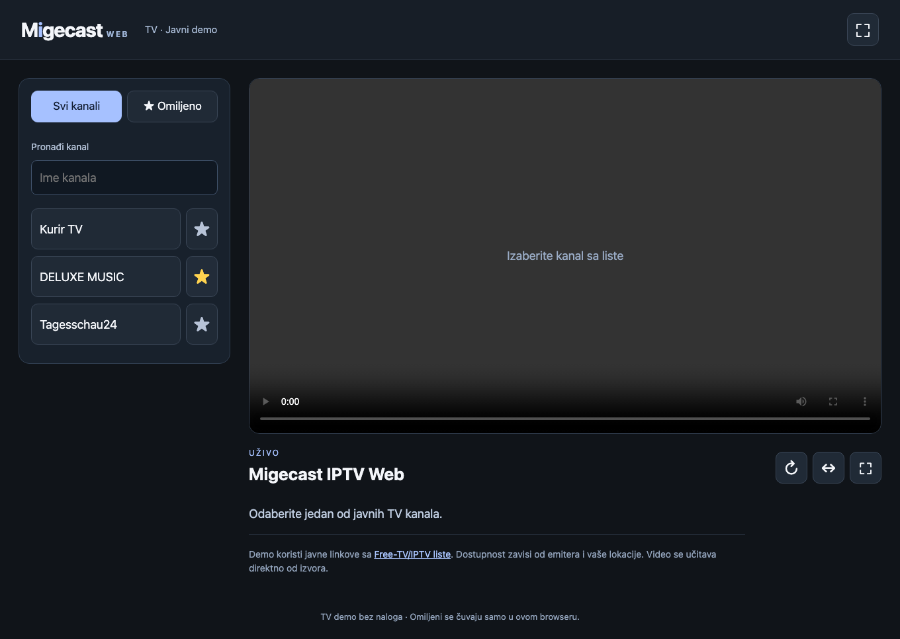

# Migecast IPTV Web

**[Watch the public demo](https://migecast-iptv-web.pages.dev/)** — opens immediately, without login.

A browser-based IPTV player with large, simple controls and a Serbian Latin interface.
The public demo includes the Free-TV/IPTV catalog organized by country — no login,
subscription or backend required. Search channels, choose a country and save favorites.



*Actual desktop interface before selecting a channel. Channel availability varies by location and source.*

## What is included?

| Edition | Features | Hosting |
| --- | --- | --- |
| Public TV demo | Country catalog, continuous scrolling, search, saved favorites, fullscreen and picture fit | Cloudflare Pages, Vercel or any static HTTPS host |
| Self-hosted application | Owner-managed accounts and playlists, live TV, movies, series, resume and per-user favorites | Your own Node.js, PostgreSQL and FFmpeg server |

This repository is a standalone public application. Movies, series and account
management belong to the self-hosted edition; the public demo has no accounts.

## Try the public demo locally

Requires Node.js 22.12+ and pnpm 10.28.2.

```sh
pnpm install --frozen-lockfile
pnpm demo:build
python3 -m http.server 4173 --bind 127.0.0.1 --directory demo/dist
```

Open http://localhost:4173. No account, database, API key or environment file is
needed. The demo does not contact a private application or proxy video through
its hosting provider. Streams go directly from the listed source to the viewer.

### Cloudflare Pages (recommended for the demo)

The public demo above is deployed with **Direct Upload**. GitHub pushes do not
update that site automatically. To publish a new reviewed snapshot, run
`pnpm demo:build` and upload `demo/dist` as a new production deployment in Pages.
For your own project with automatic Git builds, use the following settings.


Connect your repository, select **None** as the framework, use
`pnpm demo:build` as the build command and `demo/dist` as the output directory.
Use Node.js 22.12 or newer. Leave environment variables and bindings empty.
Alternatively upload the contents of `demo/dist` through Pages Direct Upload.
See [Cloudflare static HTML documentation](https://developers.cloudflare.com/pages/framework-guides/deploy-anything/).

### Vercel

Import the repository. The included `vercel.json` selects only the static demo
build and output. No Functions, database or server-side video processing is used.
The full application is not deployed by this configuration.

## Self-host the complete application

The full application preserves private account and playlist management. The
public demo is separate and cannot access your accounts or media sources.
See [self-hosting](docs/MANUAL_DEPLOYMENT.md),
[media worker](docs/WORKER_DEPLOYMENT.md) and [validation](docs/READINESS.md).

## Public channels

`demo/channels.json` contains a versioned catalog imported from the
[Free-TV/IPTV public lists](https://github.com/Free-TV/IPTV/tree/master/lists).
Only links are included; no channel logos, recordings or programme data are
redistributed. Listing a URL is not a grant of rights in its programming.
Links can stop working or be geographically restricted. HTTPS, browser-compatible
codecs and source CORS support are required for the static demo. It cannot repair
an unavailable source or bypass a source's access restrictions.

### Catalog scope and refresh

The current snapshot contains **2,051 entries across 97 countries/groups**.
**1,502** entries have a direct HTTPS HLS/video URL; that is format eligibility,
not a guarantee of playback or permission. Other entries remain searchable with
an external source link or an explanation. Duplicate entries are removed, and
credential-bearing URLs, signed links and literal private-network destinations
are not retained. No paid lists or private accounts are included.

`pnpm demo:sync` downloads the upstream playlist at a recorded Git revision and
atomically replaces the snapshot. Review the changed catalog, run tests and commit
it before deployment. The ordinary demo build uses the checked-in snapshot, so
an upstream outage cannot break an otherwise reproducible build.

The static host serves the interface only. Video travels directly from the source
to each viewer. CORS, geo-blocking, HTTPS and source availability still apply;
there is no proxy, transcoding or access-control bypass. Public availability is
not a license to rebroadcast a channel. Respect broadcaster terms and remove
entries when required.

## Development

```sh
pnpm db:generate
pnpm type-check
pnpm test
pnpm lint
pnpm demo:build
pnpm demo:test
```

Full integration tests use a fresh disposable PostgreSQL cluster; see the
validation guide. Do not point test commands at a production database.

## License

MIT for this application's code. Dependencies retain their own licenses; see
[third-party notices](THIRD_PARTY.md). The MIT license does not cover TV content.
